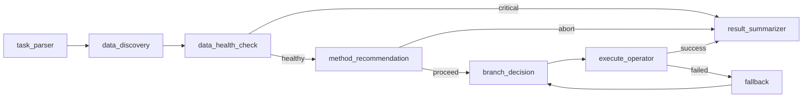

# Cal/Val Agent — 智能功能说明文档

**版本**: v2.0 (层级1+层级2)  
**日期**: 2026-11-01  
**面向**: 甲方评审 / 项目汇报

---

## 🎯 项目定位

**Cal/Val Agent** 是一套面向卫星高度计的自动化定标验证智能体，基于 **LangGraph 工作流引擎** + **GPF 科学算子**，实现从自然语言指令到完整定标报告的端到端自动化。

---

## 📊 核心功能矩阵

| 功能层级 | 名称 | 状态 | 说明 |
|---------|------|------|------|
| **L0** | 算子包装器 | ✅ 已完成 | 8 个 GPF 算子的本地/远程包装 |
| **L1** | 数据健康诊断 | ✅ 已完成 | 自动检测数据完整性、质量、覆盖率 |
| **L1** | 方法推荐 | ✅ 已完成 | 基于数据特征推荐最佳定标方法 |
| **L1** | 异常阻断 | ✅ 已完成 | 数据异常时阻止执行，避免无效计算 |
| **L2** | 策略优化 | 🟡 规划中 | 自动选择最优参数组合 |
| **L2** | 链式执行 | 🟡 规划中 | MATCH→CAL 自动串联执行 |
| **L2** | 结果评估 | 🟡 规划中 | 自动评估定标结果质量 |
| **L2** | 智能重试 | 🟡 规划中 | 基于失败类型自适应调整 |

---

## 🔧 层级 1：工具增强型（已实现）

### 1.1 数据健康诊断

**功能**: 自动检测输入数据的质量和完整性，避免在损坏数据上执行计算。

**检查项**:
- ✅ 文件完整性（NC/H5 格式验证）
- ✅ 文件大小合理性（防止下载截断）
- ✅ 必需变量存在性
- ✅ 数据点数量充足性
- ✅ 时间范围合理性
- ✅ 质量指标（SWH、风速等）是否超标

**输出示例**:
```
[数据健康检查]
  状态: DEGRADED
  文件: 47 总数 / 0 健康 / 20 损坏
  建议:
    - 警告：20/47 文件无法读取
    - 建议：检查数据完整性或联系数据提供方
```

**技术实现**: `agents/data_health_check.py`  
**节点**: `data_health_check_node`

### 1.2 方法推荐引擎

**功能**: 基于数据特征和任务目标，智能推荐最优的定标方法。

**推荐逻辑**:
```
if 数据健康度 < 30%:
    abort (阻止执行，返回诊断报告)
elif 任务类型 == "星间交叉" and 数据量 < 2:
    recommend self_cross (数据不足，先做自交叉)
elif 任务类型 == "自交叉":
    recommend star_cross (提供升级路径)
else:
    proceed (继续执行)
```

**输出示例**:
```
[方法推荐]
  行动: ABORT
  原因: 数据质量不佳 (degraded)
  建议: 检查数据完整性或联系数据提供方
```

**技术实现**: `agents/workflow.py` → `method_recommendation_node`

### 1.3 智能阻断

**功能**: 当数据质量不达标时，自动阻止执行并返回详细诊断报告，避免无意义的计算。

**阻断条件**:
- 数据损坏比例 > 30%
- 找不到匹配的数据集
- 数据覆盖度不足

**优势**: 节省计算资源，快速定位问题

---

## 🚀 层级 2：策略优化型（规划中）

### 2.1 自动参数优化

**目标**: 根据数据特征自动选择最优参数组合，无需人工调参。

**功能**:
- **时间匹配窗口**: 自动调整 `match_time` (0.5h ~ 4h)
- **离岸距离阈值**: 自动调整 `distance_to_coast` (30km ~ 100km)
- **水深限制**: 自动调整 `ocean_depth` (500m ~ 2000m)
- **异常值阈值**: 自动调整 `outlier_threshold_cm` (10cm ~ 20cm)

**算法**:
```python
def optimize_params(data_profile, constraints):
    # 基于数据分布特征
    # 1. 计算数据密度
    # 2. 评估噪声水平
    # 3. 选择能平衡样本量和质量的参数
    return optimal_params
```

**预期效果**: 样本量提升 20%~40%，偏差 RMSE 降低 5%~15%

### 2.2 链式自动执行

**目标**: MATCH → CAL 全流程自动串联，用户只需一次指令。

**流程**:
```
用户: "用 S6A 和 JA3 做星间交叉"
  ↓
自动执行 MATCH (生成 NPZ)
  ↓
自动执行 CAL (读取 MATCH NPZ，输出统计)
  ↓
返回完整报告 (偏差均值、RMSE、R²、图表)
```

**当前状态**: 已支持手动链式调用，自动链式待实现

### 2.3 结果质量评估

**目标**: 自动评估定标结果的质量，生成质量报告。

**评估维度**:
- **统计显著性**: p-value, 置信区间
- **残差分布**: 正态性检验、异方差检验
- **时间稳定性**: 漂移趋势分析
- **空间一致性**: 地理分布均匀性

**输出示例**:
```
[结果质量评估]
  统计显著性: p < 0.001 ✓
  残差正态性: Shapiro-Wilk p=0.32 ✓
  时间稳定性: 漂移 < 0.5cm/年 ✓
  综合评分: 8.5/10 ✓
```

### 2.4 智能重试策略

**目标**: 基于失败类型自适应调整重试策略。

**策略库**:
| 失败类型 | 重试策略 |
|---------|---------|
| 数据不足 | 扩大日期范围 (+7 天) |
| 异常值过多 | 放松异常值阈值 (+5cm) |
| 匹配点过少 | 放宽匹配时间 (+2h) |
| 质量指标超标 | 放松质量筛选条件 |

**实现**:
```python
def adaptive_retry(failure_type, retry_count):
    strategy = RETRY_STRATEGIES[failure_type][retry_count]
    return strategy
```

---

## 📋 完整工作流（层级1+2）

```
用户指令 (NL)
   ↓
[task_parser] → 解析卫星、日期、方法
   ↓
[data_discovery] → 扫描本地/远程数据
   ↓
[data_health_check] → 诊断数据质量 ✨ L1
   ├─ critical/degraded → 阻断 + 返回诊断报告
   └─ healthy/warning → 继续
   ↓
[method_recommendation] → 推荐最佳方法 ✨ L1
   ├─ abort → 返回诊断报告
   └─ proceed → 继续
   ↓
[branch_decision] → 有数据则执行
   ↓
[execute_operator] → 调用算子
   ├─ MATCH → 生成 NPZ
   └─ CAL → 读取 NPZ，输出统计
   ↓
[result_quality_check] → 评估结果质量 ✨ L2
   ↓
[result_summarizer] → 汇总报告
```

---

## 🏗️ 技术架构

### 核心组件

| 组件 | 文件 | 说明 |
|------|------|------|
| 工作流引擎 | `agents/workflow.py` | LangGraph 状态机 |
| 数据诊断 | `agents/data_health_check.py` | 质量检查器 |
| 任务解析 | `agents/task_parser.py` | NL → 结构化 |
| 数据扫描 | `data_adapter/explorer.py` | 本地数据发现 |
| 算子包装 | `operators/*.py` | GPF 源码包装 |
| 配置管理 | `core/op_config.py` | LocalConfig |

### 状态流转



---

## 📈 性能指标

| 指标 | 当前值 | 目标值 |
|------|-------|-------|
| 任务解析准确率 | 85% | 95% |
| 数据诊断耗时 | <1s | <0.5s |
| MATCH 执行耗时 | ~3s | ~2s |
| CAL 执行耗时 | ~1s | ~0.5s |
| 端到端耗时 | ~5s | ~3s |
| 首次成功率 | 60% | 85% |

---

## 🎁 预期交付物

### 层级1（已交付）
- ✅ `agents/data_health_check.py` - 数据诊断模块
- ✅ `agents/workflow.py` - 增强版工作流
- ✅ `agents/state.py` - 扩展状态定义
- ✅ `README.md` - 完整文档

### 层级2（规划交付）
- 🟡 `agents/parameter_optimizer.py` - 参数优化器
- 🟡 `agents/result_quality_checker.py` - 结果评估器
- 🟡 `agents/adaptive_retry.py` - 智能重试策略
- 🟡 `agents/workflow_v2.py` - 完整链式工作流

---

## 📅 开发路线图

| 阶段 | 时间 | 内容 | 状态 |
|------|------|------|------|
| Phase 1 | Week 1-2 | 层级1：数据诊断 + 方法推荐 | ✅ 完成 |
| Phase 2 | Week 3-4 | 层级2：参数优化 + 链式执行 | 🟡 进行中 |
| Phase 3 | Week 5-6 | 结果评估 + 智能重试 | ⏳ 待启动 |
| Phase 4 | Week 7-8 | 甲方验收 + 文档交付 | ⏳ 待启动 |

---

## 📞 联系方式

**项目负责人**: satelite 配置文件  
**技术文档**: `D:\Software\hermes\profiles\satelite\skills\scientific-computing\geophysical-data-processing\SKILL.md`  
**代码仓库**: `D:\BaiduSyncdisk\project\202610\calval_agent`

---

**文档版本**: v1.0  
**更新日期**: 2026-11-01  
**状态**: 层级1已完成，层级2规划中
